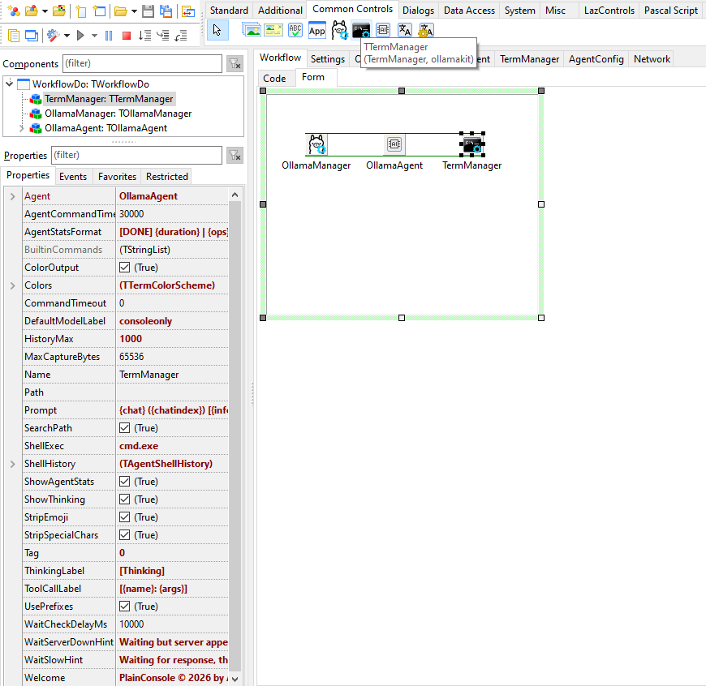

# OllamaKit

**OllamaKit** is a set of Lazarus / Free Pascal visual components for building desktop applications around [Ollama](https://ollama.com) — a local and remote large language model (LLM) server.

[](https://opensource.org/licenses/MIT)
[](https://www.lazarus-ide.org/)
[](#)



The package provides reusable building blocks that together deliver the following capabilities:

- an **asynchronous Ollama API client** with REST support and Server-Sent-Events (SSE) streaming,
- **model lifecycle management** (list, pull, start, stop, delete, copy, create, inspect, version),
- **streaming chat** with thinking and content callbacks,
- a **tool-calling LLM agent** with a complete agent loop, context management and history compaction,
- an **interactive terminal component** that hosts both shell commands and agent-driven sessions,
- **configuration, help and model-list helper** functions.

---

## Requirements

- **Lazarus** 3.x or newer (developed against Lazarus 4.8 with Free Pascal 3.2.2),
- **Free Pascal Compiler** (FPC) 3.2.x,
- Required Lazarus packages (all of them must be installed in the environment):

  | Package | Purpose |
  |---|---|
  | `LCLBase` | Base Lazarus class library support |
  | `IDEIntf` | Design-time integration (property editors, component registration) |
  | `helpers` | General helper utilities used by the units |
  | `toolkit` | HTTP / networking / string helper utilities; requires `laz_synapse` as its dependency |
  | `laz_synapse` | HTTP / web-socket transport required by the `toolkit` package |

---

## Main Functionality

### Ollama API client (`TOllamaManager`)

- Asynchronous refresh of installed / running model lists (`RefreshModels`).
- Background operations: pull, start, stop and refresh via a dedicated worker thread (`TOllamaBgThread`).
- Streaming pull progress with per-model percent updates (`OnPullProgress`).
- Chat and generate requests with SSE streaming (`ChatStream`, `ChatWithTools`) or plain JSON (`Chat`, `Generate`).
- Error handling with typed error kinds (`TOllamaErrorKind`) and retry logic for transient failures only.
- Server state queries: model context length, running model JSON, quick reachability check, version.
- Optional popup menu integration for model management actions.

### LLM agent (`TOllamaAgent`)

- Multi-step agent loop driven by the model, with a finish condition and maximum step limit.
- Streaming responses with content and thinking callbacks.
- Tool calling: built-in tools plus user-defined tools registered through a tool collection.
- Host-controlled routing (`OnRoute`) and execution hooks (`OnExecCommand`, `OnAskUser`, `OnToolResult`, ...).
- Context usage tracking and automatic history compaction.
- Multi-chat support with persistence (`NewChat`, `SwitchChat`, `SaveChatsToFile`, ...).

### Interactive terminal (`TTermManager`)

- Full-screen style interactive loop (`Run` / `Stop`).
- Input classification: empty, built-in, external shell command and agent command.
- Built-in commands (`cls`, `help`, `exit`, ...) and external shell execution with output capture.
- Agent session handling: prompt injection, streaming rendering, markdown processing, thinking blocks, tool call display, statistics and finish handling.

### Helpers (`AgentConfig`)

- Help text formatting, agent property get/set, features formatting, installed-models listing.

---

## Project Structure

```
ollamakit.lpk              Package project file
ollamakit.pas               Package unit stub (compilation / installation)
ollamakitregister.pas       Design-time component and property editor registration
ollamakit.lrs / ollamakit.rc  Resource scripts
src/
  ollamamanager.pas         TOllamaManager / TCustomOllamaManager (Ollama API client)
  ollamaagent.pas           TOllamaAgent / TCustomOllamaAgent (LLM agent)
  termmanager.pas           TTermManager / TCustomTermManager (interactive terminal)
  agentconfig.pas           Helper functions for commands, help and configuration
img/                        Icons
lib/<target>                Compiled output
```

---

## Component Interaction

The components form a single pipeline:

```
User input (terminal)
        |
        v
TTermManager.Run -> ReadLine -> ClassifyLine -> DoRoute -> dispatch
        |
        |-- tikBuiltin  -> HandleBuiltin / ExecuteCommand
        |-- tikCommand  -> ExecuteCommand (shell)
        `-- tikAgent   -> TCustomOllamaAgent.RunAsync
                          |
                          v
                   TOllamaAgentThread (worker)
                          |
                          v
                   TOllamaManager (ChatStream / ChatWithTools / Generate / Chat)
                          |
                          v
                   Ollama server (HTTP / SSE)
                          |
                          v
        Agent events -> TTermManager handlers -> console rendering
```

`TTermManager` owns an `TOllamaAgent` instance (property `Agent`). The agent owns / receives an `TOllamaManager` instance (property `OllamaManager`) which performs the actual HTTP calls. The terminal installs temporary agent event handlers (`OnChunk`, `OnThinking`, `OnToolCall`, `OnToolResult`, `OnFinish`, `OnExecCommand`, `OnAskUser`, `OnLog`, `OnContextUsage`) while a run is active and restores the previous handlers afterwards.

---

## Components

### 1. `TOllamaManager` (`src/ollamamanager.pas`)

Namespace / class names: `OllamaManager`, `TOllamaManager`, `TCustomOllamaManager`.

**Purpose:** asynchronous Ollama API client that hides the HTTP transport behind a background worker thread and provides the model lifecycle management, streaming chat and generate requests, typed error handling and server state queries.

**Properties:**

| Property | Type | Description |
|---|---|---|
| `BaseURL` | `string` | Base address of the Ollama server, e.g. `http://localhost:11434`. |
| `PopupMenu` | `TPopupMenu` | Popup menu that receives the model management items; may be nil. |
| `KeepAlive` | `Integer` | `keep_alive` value sent with start requests; `-1` means no time limit. |
| `NumCtx` | `Integer` | `num_ctx` value sent with requests, `0` means use Ollama default. |
| `ThinkMode` | `TOllamaThinkMode` | Thinking mode sent with chat requests, e.g. `default`, `on`, `off`, `low`, `medium`, `high`. |
| `Active` | `Boolean` | Master switch; when False no connection attempts are made and the menu is empty. |
| `AutoRefresh` | `Boolean` | When True, the model list is refreshed before each menu popup. |
| `ConnectionTimeout` | `Integer` | Connection timeout in milliseconds, applied while establishing the connection. |
| `ModelTimeout` | `Integer` | Maximum time in milliseconds to wait for a model start or stop operation. |
| `RequestTimeout` | `Integer` | Timeout in milliseconds for regular API requests. |
| `PullTimeout` | `Integer` | Per-chunk timeout in milliseconds during pull, `0` means use `RequestTimeout`. |
| `MenuSections` | `TOllamaMenuSections` | Sections of the popup menu shown to the user; clear a flag to hide it. |
| `MonitorModelState` | `Boolean` | Enables periodic monitoring of running model state. |
| `MonitorInterval` | `Integer` | Polling interval in milliseconds. |

**Methods:**

| Method | Description |
|---|---|
| `RefreshModels` | Triggers a background refresh of the model lists. |
| `PullModel` | Starts an asynchronous model pull. |
| `DeleteModel` | Deletes a model. |
| `StartModel` / `StopModel` | Start / stop a loaded model. |
| `Connect` / `Disconnect` | Enable / disable connection attempts. |
| `Generate` | Non-streaming generate. |
| `Chat` | Non-streaming chat. |
| `ChatStream` | Streaming chat with SSE or plain JSON; returns the final chunk or reports an error. |
| `ChatWithTools` | Streaming or non-streaming chat with tools support; emits thinking and content. |
| `ShowModel` | Fetches model metadata JSON. |
| `GetVersion` | Returns the server version. |
| `CopyModel` | Copies a model. |
| `CreateModel` | Creates a model from a Modelfile. |
| `LoadModelSync` / `UnloadModelSync` | Synchronous load / unload. |
| `ResetUsage` | Resets usage counters. |
| `GetLastUsageTotal` | Returns the last usage total. |
| `GetModelContextLength` | Returns the context length of a loaded model. |
| `GetRunningModelJson` | Returns cached /api/ps JSON for a running model. |
| `CheckServerReachableQuick` | Quick TCP-only reachability check. |
| `BgFinished` | Called by the background thread via Synchronize. |
| `UnregisterThread` | Unregisters a background thread. |

**Events:**

| Event | Description |
|---|---|
| `OnModelsRefreshed` | Fired after the installed model list has been refreshed. |
| `OnError` | Fired for any API or connection error; never raises. |
| `OnPullProgress` | Fired when pull progress changes (currently only start and finish). |
| `OnConnecting` | Fired before a background connection or refresh attempt begins. |
| `OnConnected` | Fired after the model list has been successfully refreshed. |
| `OnModelStart` | Occurs when a model start operation completes; `Success` indicates whether the operation completed successfully. |
| `OnModelStop` | Occurs when a model stop operation completes; `Success` indicates whether the operation completed successfully. |

---

### 2. `TOllamaAgent` (`src/ollamaagent.pas`)

Namespace / class names: `OllamaAgent`, `TCustomOllamaAgent`, `TOllamaAgent`.

**Purpose:** LLM agent that runs a tool-calling loop on top of `TOllamaManager`. The agent builds the system prompt, manages conversation history and context usage, streams responses and executes tool calls until the finish condition, step limit, cancellation or an error occurs.

**Properties:**

| Property | Type | Description |
|---|---|---|
| `OllamaManager` | `TOllamaManager` | Ollama API client used for chat requests. |
| `ModelName` | `string` | Model name passed to Ollama, e.g. `qwen2.5-coder:7b`. |
| `SystemPrompt` | `string` | System message sent before the conversation. |
| `MaxSteps` | `Integer` | Maximum number of agent iterations, zero means unlimited. |
| `RequestTimeout` | `Integer` | Per-request timeout in ms, 0 means use `OllamaManager` default. |
| `Streaming` | `Boolean` | Enable streaming of content and thinking chunks in real time. |
| `ThinkMode` | `TOllamaThinkMode` | Model thinking mode for agent runs, e.g. `default`, `on`, `off`, `low`, `medium`, `high`. |
| `EnabledTools` | `TAgentFeatures` | Tool groups enabled for this agent, empty means chat only. |
| `RootPath` | `string` | Sandbox directory for file tools, empty means process cwd. |
| `ToolPathAliases` | `TStringList` | Virtual path aliases resolved relative to `RootPath`. |
| `Tools` | `TAgentTools` | Collection of user-defined tools. |
| `WebOptions` | `TAgentWebOptions` | Web tools configuration, expand to adjust search URL, timeout, whitelist. |
| `KeepHistory` | `Boolean` | When True, messages persist between `RunAsync` calls. |
| `LoadAgentsMd` | `Boolean` | Load workspace root `AGENTS.md` into the system prompt. |
| `AgentsFileName` | `string` | Instruction file name, looked up in the root and in subdirectories. |
| `AllowAccessToSystem` | `Boolean` | When False, file tools are sandboxed to `RootPath`, absolute paths are rejected. |
| `BlockSensitiveFiles` | `Boolean` | Deny access to well-known secret files like `.ssh/`, `.env`, `*.key`, `id_rsa`. |
| `Log` | `Boolean` | When True, the agent logs every step and event to stderr. |
| `LogToolResult` | `Boolean` | Emit tool result previews through the log channel, truncated to 500 chars. |
| `OnLog` | `TAgentLogEvent` | Receives every log line, host may color or redirect it. |
| `OnContextUsage` | `TAgentContextUsageEvent` | Fired with current context usage counters. |
| `OnRoute` | `TAgentRouteEvent` | Fired before chat step and each tool call, host may reject. |
| `OnChunk` | `TAgentChunkEvent` | Fired for every streamed text chunk from the model. |
| `OnThinking` | `TAgentThinkingEvent` | Fired for every thinking chunk from the model. |
| `OnToolCall` | `TAgentToolCallEvent` | Fired when the LLM requests a tool, after host approval. |
| `OnToolResult` | `TAgentToolResultEvent` | Fired with the tool result before it is sent back to the model. |
| `OnExecCommand` | `TAgentExecCommandEvent` | Fired for exec_command tool, host executes and returns the output. |
| `OnAskUser` | `TAgentAskUserEvent` | Fired for ask_user tool, host shows the question and returns the answer. |
| `OnFinish` | `TAgentFinishEvent` | Fired once when the run terminates for any reason. |

**Methods:**

| Method | Description |
|---|---|
| `RunAsync` | Runs the agent asynchronously with the given text. |
| `Run` | Runs the agent and returns the final answer. |
| `Cancel` | Cancels the active run. |
| `ClearHistory` | Clears the conversation history. |
| `RemoveLastExchange` | Removes the last user message and all following messages. |
| `NewChat` | Creates and activates a new chat. |
| `SwitchChat` | Switches to the adjacent chat, negative values select older chats. |
| `MoveActiveChat` | Moves the active chat in the chat list without switching it. |
| `DeleteActiveChat` | Deletes the active chat and activates the next available chat. |
| `ClearChats` | Deletes all chats without creating a new one. |
| `SaveChatsToFile` | Saves all chats to a JSON file. |
| `LoadChatsFromFile` | Loads all chats from a JSON file. |
| `SaveChatToFile` | Saves the specified chat to a separate JSON file. |
| `LoadChatFromFile` | Loads a chat from a separate JSON file and activates it. |
| `BuildSystemPrompt` | Builds the system prompt using the current runtime capabilities. |
| `RefreshContextInfo` | Resolves model context window size and updates context counters. |
| `ResetUsage` | Resets usage counters in the manager and the agent. |
| `DispatchTool` | Dispatches one tool call, called by the worker thread. |
| `BuildUnknownToolError` | Builds an actionable error listing available tools and hints. |
| `ModelSupportsTools` | Returns False when the model definitely lacks tool support. |
| `SummarizeMessages` | Compresses a JSON array of messages into a short summary string. |
| `BuildToolsSchemaJson` | Builds JSON schema array with all available tools. |
| `BuildToolsNames` | Returns comma-separated list of tool names for diagnostics. |
| `LogLine` | Writes a diagnostic line to stderr when Log is enabled. |
| `DoLog` | Emits a log line through OnLog or stderr, no Log flag check. |
| `EmitToolResult` | Emits a truncated tool result preview when LogToolResult is enabled. |

**Events:**

| Event | Description |
|---|---|
| `OnLog` | Receives every log line, host may color or redirect it. |
| `OnContextUsage` | Fired with current context usage counters. |
| `OnRoute` | Fired before chat step and each tool call, host may reject. |
| `OnChunk` | Fired for every streamed text chunk from the model. |
| `OnThinking` | Fired for every thinking chunk from the model. |
| `OnToolCall` | Fired when the LLM requests a tool, after host approval. |
| `OnToolResult` | Fired with the tool result before it is sent back to the model. |
| `OnExecCommand` | Fired for exec_command tool, host executes and returns the output. |
| `OnAskUser` | Fired for ask_user tool, host shows the question and returns the answer. |
| `OnFinish` | Fired once when the run terminates for any reason. |

---

### 3. `TTermManager` (`src/termmanager.pas`)

Namespace / class names: `TermManager`, `TCustomTermManager`, `TTermManager`.

**Purpose:** interactive terminal component that hosts shell commands and agent-driven sessions. It classifies user input, renders shell and agent output, handles built-in commands and drives agent runs through temporary event handlers.

**Properties:**

| Property | Type | Description |
|---|---|---|
| `Path` | `string` | Working directory for shell commands and agent file tools, empty uses process cwd. |
| `Prompt` | `string` | Prompt template, supports `{path}`, `{model}`, `{chat}`, `{chatindex}`, context and usage placeholders. |
| `StartupPrompt` | `string` | Multi-line banner printed once before the first prompt. |
| `ThinkingLabel` | `string` | Line printed before agent reasoning block, for example `[Thinking]`. |
| `ShowThinking` | `Boolean` | Show agent reasoning text; when False only ThinkingLabel is printed. |
| `ShowAgentStats` | `Boolean` | Completion statistics template; supports `{duration}`, `{ops}`, `{tool_count}`, `{tool_duration}`, `{thinking_count}`, `{thinking_duration}`, `{answer_count}`, `{answer_duration}`. |
| `AgentStatsFormat` | `string` | Completion statistics template with duration and operation placeholders. |
| `ToolCallLabel` | `string` | Line printed before each tool call, supports `{name}`, `{args}` and JSON field placeholders like `{command}`. |
| `StripEmoji` | `Boolean` | Strip emoji and unsupported symbol ranges that plain console fonts cannot render. |
| `StripSpecialChars` | `Boolean` | Normalize text for terminal output. |
| `ColorOutput` | `Boolean` | Colorize badges and thinking text when console supports attributes. |
| `Colors` | `TTermColorScheme` | Semantic color palette for output, expand to customize each role. |
| `DefaultModelLabel` | `string` | Label shown in the `{info}` badge when no model is selected. |
| `WaitSlowHint` | `string` | Hint shown when the agent waits longer than a second with reachable server. |
| `WaitServerDownHint` | `string` | Hint shown when the agent waits longer than a second with unreachable server. |
| `WaitCheckDelayMs` | `Integer` | Delay in ms before checking server reachability, `0` disables the check. |
| `BuiltinCommands` | `TStringList` | Commands executed internally without invoking the shell, extend to add your own. |
| `HistoryMax` | `Integer` | Maximum number of input lines kept in history, oldest are dropped first. |
| `ShellExec` | `string` | Shell executable used to run external commands and agent exec_command, defaults to cmd.exe. |
| `CommandTimeout` | `Integer` | Timeout in milliseconds for user-typed external commands, zero means no limit. |
| `MaxCaptureBytes` | `Integer` | Cap on bytes captured from agent exec_command, excess is truncated with a notice. |
| `AgentCommandTimeout` | `Integer` | Timeout in milliseconds for agent exec_command, zero means no limit, default 30 seconds. |
| `UsePrefixes` | `Boolean` | Enable `!` and `?` prefixes to force command or agent routing respectively. |
| `ShellHistory` | `TAgentShellHistory` | Pass recent shell commands to the agent, expand to adjust log limits. |
| `SearchPath` | `Boolean` | Also detect PATH executables and known shell builtins when classifying input. |
| `OnRoute` | `TTermRouteEvent` | Fires before routing each input, host can approve, reject or reclassify it. |
| `OnOutput` | `TTermOutputEvent` | Fires for every chunk of command output, useful for logging or filtering. |
| `OnAgentExecute` | `TTermAgentEvent` | Fires when input is classified as agent text and no Agent is attached. |
| `OnExit` | `TTermExitEvent` | Fires when the interactive loop terminates, receives last command exit code. |
| `Agent` | `TCustomOllamaAgent` | Agent component that handles agent-classified input, leave empty to disable. |

**Methods:**

| Method | Description |
|---|---|
| `Run` | Starts the interactive loop and blocks until exit. |
| `Stop` | Requests the loop to stop after current iteration. |
| `ExecuteCommandCapture` | Runs shell command capturing output as UTF-8, returns combined stdout and stderr. |
| `WriteText` | Writes raw text without line ending, flushes for streaming output. |
| `WriteLine` | Writes text followed by a line ending, flushes immediately. |
| `FormatTermConfig` | Returns multi-line current values of term properties. |
| `RestoreActiveChat` | Restores terminal buffers and output of the active chat. |
| `HandleBuiltin` | Handles built-in commands. |
| `ExecuteCommand` | Runs external shell command. |
| `ClassifyLine` | Classifies input line. |
| `DoRoute` | Routes input. |
| `DoOutput` | Outputs text. |
| `DoAgentExecute` | Executes agent input. |
| `DoExit` | Exits. |
| `CloseThinking` | Closes thinking block. |
| `ProcessMarkdownChunk` | Processes markdown chunk. |
| `ProcessMarkdownLine` | Processes markdown line. |
| `RecordShellOperation` | Records shell operation. |
| `BuildShellContext` | Builds shell context. |
| `IsMetaCommand` | Checks meta command. |
| `IsChatControlCommand` | Checks chat control command. |
| `HandleAgentExecCommand` | Handles agent exec command. |
| `HandleAgentAskUser` | Handles agent ask user. |

**Events:**

| Event | Description |
|---|---|
| `OnRoute` | Fires before routing each input, host can approve, reject or reclassify it. |
| `OnOutput` | Fires for every chunk of command output, useful for logging or filtering. |
| `OnAgentExecute` | Fires when input is classified as agent text and no Agent is attached. |
| `OnExit` | Fires when the interactive loop terminates, receives last command exit code. |

---

### 4. `AgentConfig` (`src/agentconfig.pas`)

**Purpose:** helper unit with pure functions for command handling, help formatting, agent property get/set, features formatting and installed-models listing.

**Functions:**

| Function | Description |
|---|---|
| `FormatShortHelp` | Formats short help. |
| `FormatFullHelp` | Formats full help. |
| `FormatOllamaHelp` | Formats Ollama help. |
| `FormatAgentConfig` | Formats agent config. |
| `GetAgentProperty` | Gets agent property. |
| `SetAgentProperty` | Sets agent property. |
| `FormatModelsList` | Formats models list. |
| `TModelListCollector` | Event helper for model list collection. |

---

## Using the Components in the Designer

The components can be placed directly on a Lazarus form at design time.

1. Install the `ollamakit` package and its dependencies (`LCLBase`, `IDEIntf`, `helpers`, `toolkit`, `laz_synapse`).
2. Open the Tool Palette and drop the following components onto a form:
   - `TTermManager` (`TermManager`),
   - `TOllamaAgent` (`OllamaAgent`),
   - `TOllamaManager` (`OllamaManager`).
3. Wire the object hierarchy through properties:
   - `TTermManager.Agent` → an instance of `TOllamaAgent` (the terminal drives the agent),
   - `TOllamaAgent.OllamaManager` → an instance of `TOllamaManager` (the agent performs HTTP calls through it),
   - `TOllamaManager.BaseURL` → the Ollama server base URL (default `http://localhost:11434`).
4. Optionally configure:
   - `TTermManager.Path` — working directory for shell commands and agent file tools,
   - `TOllamaAgent.ModelName` — default model,
   - `TOllamaManager.KeepAlive` / `TOllamaManager.NumCtx`,
   - `TOllamaAgent.ThinkMode` — thinking mode for model responses, e.g. `high`,
   - `TTermManager` timeouts and `MenuSections`.
5. Subscribe to events, for example:
   - `TOllamaManager.OnError`, `TOllamaManager.OnConnected`, `TOllamaManager.OnModelsRefreshed`, `TOllamaManager.OnPullProgress`, `TOllamaManager.OnModelStart`, `TOllamaManager.OnModelStop`,
   - `TOllamaAgent.OnChunk`, `TOllamaAgent.OnThinking`, `TOllamaAgent.OnToolCall`, `TOllamaAgent.OnToolResult`, `TOllamaAgent.OnFinish`, `TOllamaAgent.OnExecCommand`, `TOllamaAgent.OnAskUser`, `TOllamaAgent.OnLog`, `TOllamaAgent.OnContextUsage`, `TOllamaAgent.OnRoute`,
   - `TTermManager.OnOutput`, `TTermManager.OnAgentExecute`, `TTermManager.OnExit`, `TTermManager.OnRoute`.

Because the package registers its components and property editors at design time (`OllamaKitRegister`), the components and multiline editors for `Welcome`, `SystemPrompt`, `Description` and `ParametersJson` are available immediately after installation.

---

## Installation

1. Open the `ollamakit` package in Lazarus and select the **Install Package** button.

---

## License

MIT License — see the `LICENSE` file for details.
